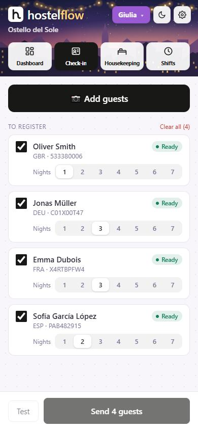
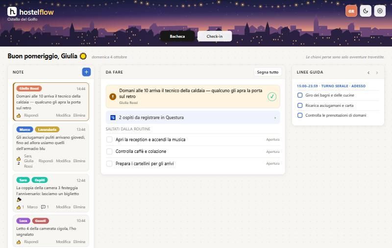

# HostelFlow

**Guest check-in and police registration for small accommodation — hostels,
B&Bs, holiday flats. Free and open source. Built for Italy and used every day
at a hostel reception in La Spezia.**

Take a photo of the guest's ID → AI reads it → staff check the fields → one
tap sends the guests to the police (**Alloggiati Web**). From the same data:
**ISTAT** statistics (Ross1000, RiMovCli C/59 for Liguria). Around it: a team
Dashboard, Housekeeping (beds and linen), Shifts, a Calendar (beta), team
members with permissions and an assistant (Flowy). Interface in English,
Italian, Spanish and French.

👉 **Use it for free at [hostelflow.it](https://hostelflow.it)** — nothing to
install, it runs in the browser on phone and computer. Or run your own copy
(below).

> 🇮🇹 **In italiano:** fotografi il documento dell'ospite, HostelFlow legge i
> dati e li invia ad Alloggiati Web con un clic — anche gruppi e famiglie. Con
> ISTAT, Ross1000 e RiMovCli dagli stessi dati. Gratis, su
> [hostelflow.it](https://hostelflow.it).

<p>
  
  
</p>

HostelFlow started as a small business and is now free and open source, so
that anyone can use it, run it or take parts of it. The hosted version at
hostelflow.it is looked after; a copy you run yourself comes as is.

If it saves you time at the reception, you can support it at
[ko-fi.com/hostelflow](https://ko-fi.com/hostelflow) ☕

## What you may find useful even without the whole app

- `src/registration/it/` — **Alloggiati Web** (Polizia di Stato) over its
  SOAP service: token, test, send, the schedule tables (comuni, countries,
  document types) and validation. Tested in daily use.
- `src/stats/` — **ISTAT C/59** exports: Ross1000, and RiMovCli XML for
  Regione Liguria (the format the region confirmed), with
  `docs/istat/rimovcli/GUIDE.md`.
- `src/ocr.js` + `src/mrz.js` — reading identity documents with Claude
  (structured output; the MRZ check digits settle the sex and dates).
- `src/registration/cz/` (Ubyport) and `src/registration/fr/` (fiche de
  police) — written, never tried with a real property.

## How it is built

- One **Cloudflare Worker** (`src/worker.js`, API in `src/api.js`), a **D1**
  database (SQLite; schema in `migrations/`), an **R2** bucket for The Vault
  (files), an hourly cron (deletes document photos, sends usage, reminders).
- Frontend in `public/` with **no build step**: `index.html`, `app.css` and
  plain scripts in `public/js/` that share one global scope.
- Each backend file starts with a comment saying what it does and why.
- Tests: `node --test` (D1 is emulated over `node:sqlite` with the real
  migrations; tests call `worker.fetch` with a fake `env`).

## Running your own copy

You need a Cloudflare account (the free plan is enough to start) and
Node.js 22+.

```bash
npm install
npx wrangler login
npx wrangler d1 create hostelflow          # put the database_id into wrangler.toml
npx wrangler r2 bucket create hostelflow-vault
node -e "console.log(btoa(String.fromCharCode(...crypto.getRandomValues(new Uint8Array(32)))))"
npx wrangler secret put CREDENTIALS_KEY    # paste the value printed above; keep a copy safe
npx wrangler d1 migrations apply hostelflow --remote
npx wrangler deploy
```

Then open `https://hostelflow.<your-account>.workers.dev/app` and sign up:
the first account owns the first property.

**Claude (document scans and Flowy).** Each property connects its own
Claude account in *Settings → Check-in scan*: an API key from
[platform.claude.com](https://platform.claude.com/), where it also buys
credit (turn on auto-reload so it never runs out). Scans then cost the
property directly at Anthropic, roughly a cent each. If you'd rather pay for
everyone, set a server-wide key instead: `npx wrangler secret put ANTHROPIC_API_KEY`.

**Optional secrets**

| Secret | What for | Without it |
|---|---|---|
| `ANTHROPIC_API_KEY` | scans for properties with no key of their own | each property connects its own |
| `RESEND_API_KEY` (+ `MAIL_FROM` in `wrangler.toml`) | e-mails: address check, password reset, alerts | no e-mails are sent |
| `STRIPE_SECRET_KEY`, `STRIPE_WEBHOOK_SECRET` (+ prices in `wrangler.toml`) | subscriptions | billing is off, everything is free |
| `ANTHROPIC_ADMIN_KEY` | Claude spend in the admin centre | that card stays empty |

**Admin centre** (all properties at a glance): set `ADMIN_HOST` in
`wrangler.toml` to a domain of yours routed to the Worker, then create an
account with `node scripts/admin-user.mjs`.

**Your own domain and name.** The code says `hostelflow.it` in a few places
(e-mail sender, support address, public pages, canonical links). Search for
it and put in yours. The public pages (`/welcome`, SEO pages) can be hidden
with `SITE_HIDDEN` in `src/site.js`.

**Legal texts.** `docs/legal/` holds the privacy policy and terms HostelFlow
used, as templates. Whoever runs a copy is the provider: fill in your details,
have them checked, then `npm run build:legal`.

**Personal data.** The app is built so that guests' details never end up in
logs, alerts or the admin centre, document photos are deleted after sending
(48 hours at most) and police logins are encrypted. Running a copy for
others still makes you their data processor under the GDPR.

## Working on it

```bash
cp .dev.vars.example .dev.vars   # local secrets, never committed
npx wrangler d1 migrations apply hostelflow --local
npx wrangler dev                 # http://localhost:8787/app
node --test
```

Rules the code follows: every row belongs to a property (`property_id` in
every table and query); a database change is a new numbered migration;
no inline scripts (strict CSP); every UI text is translated in
`public/i18n.js`, `i18n-es.js` and `i18n-fr.js` (a test checks it).
After changing anything in `public/`, raise `CACHE` in `public/sw.js` so
installed apps pick up the new version.

## Licence

Copyright © 2026 Robert Herman.

[GNU Affero General Public License v3.0 or later](LICENSE): you may use,
change and share it; if you offer a changed version as a service, publish
your changes under the same licence.
